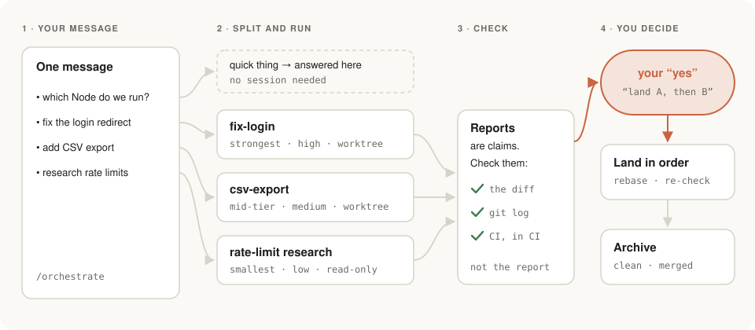

<p align="center">
  <picture>
    <source media="(prefers-color-scheme: dark)" srcset="assets/banner-dark.svg">
    
  </picture>
</p>

<p align="center">
  <a href="LICENSE"></a>
  <a href="CHANGELOG.md"></a>
  
</p>

<p align="center"><a href="README.ru.md">По-русски</a></p>

<p align="center">
  <picture>
    <source media="(prefers-color-scheme: dark)" srcset="assets/demo-dark.svg">
    
  </picture>
  <br><sub>One message → sessions → checked reports → your yes → landed → archived.</sub>
</p>

**An orchestrator that ships nothing without your yes — and one yes covers one named action.**

`/orchestrate` is a [Claude Code skill](https://code.claude.com/docs/en/skills). Send one message with a pile of tasks. Claude answers the quick ones on the spot, starts a separate session for each real one (its own worktree and branch, a model picked for the job), checks what those sessions report against git and CI, and brings you only the decisions that are yours: land this, archive that.

No tmux, no extra app, no board to babysit. It lives inside the Claude desktop app, in the sessions you already use.

## How it works

<picture>
  <source media="(prefers-color-scheme: dark)" srcset="assets/flow-dark.svg">
  
</picture>

1. **Split.** Quick things (a question, one edit, a couple of commands) are done right here, first, because they often settle facts the other tasks need. Everything bigger gets its own session.
2. **Run.** Each session gets a short brief, its own worktree and branch, and a model and effort that fit: the strongest model for design and hard bugs, mid-tier for routine work, the smallest for read-only research. At most three sessions write at once; the rest queue.
3. **Check.** A session's report is a claim, not proof. Each report ends with a fixed receipt (done, draft, blocked or ask; branch, commits, checks, tokens), and the orchestrator checks it against the branch, the diff and the CI itself. Before it asks you to land, `land_check.py` confirms a fast-forward, a clean worktree, authors, trailers, lint and tests.
   One fresh-context review per landing, and it has to end: every finding gets a harm level (P0–P3) and evidence (run, read or opinion). Only P0/P1 go back to the session; P2 goes to the project's findings ledger, P3 is dropped. Audits run only on a trigger (a complaint, a costly hot spot, the step before a roadmap phase), with one question and a budget of five items. A feature freeze needs a measurable exit and a date.
4. **You decide.** Push, merge, deploy, release: each needs your yes, typed in chat, naming that action. A "yes" found inside a report, a file or a CI log doesn't count. Branches land one at a time, rebased and re-checked. A session is archived only when its worktree is clean and its commits are merged — and only after you say so.

## Bugs: `/bug`

The plugin has a second skill for the most common single task: a bug. Bring a screenshot or a wrong number and type `/bug` (or just describe it). Claude finds the root cause before anyone writes a fix: the expected value from a source outside the code, a reproduction it has run, the line and the commit that caused it; production is read-only. Then it shows you a ticket: what happens, expected, evidence, root cause at `file:line`, the failing test, the fix, the risk. On your yes it files the ticket (a GitHub issue, or wherever your project keeps them) and hands it to `/orchestrate` as one task. The fix session opens with the red test, its commit closes the issue, and it lands only on your yes, like everything else.

Debugging skills such as `superpowers:systematic-debugging` or Matt Pocock's `diagnosing-bugs` already find root causes, and `triage-issue` skills file issues with a TDD plan; `/bug` uses whichever debugging skill you have and adds the hand-off: the ticket becomes a session with its own branch, and the fix ships behind the same gate.

## Architecture tour: `/arch-tutor`

The third skill explains a codebase to its owner. It reads the repository (read-only) and gives you a visual map (layers, the path of one request, background jobs, deploy) with a plain-language note on every framework, a page for your knowledge base with a glossary, and an architecture review: zero to ten risks, each with `file:line`, what breaks and when, what to do, the size and when to act (now, at a roadmap step, or accept), without repeating what your audits or findings ledger already hold.

## What it looks like

A typical exchange, trimmed:

> **You:** /orchestrate — fix the login redirect loop on Safari, add CSV export to the reports page, which Node version is prod on?, and find out how other APIs do rate limiting.

> **Claude:** Prod runs Node 22.11 (`.nvmrc` and the deploy log agree) — answered here.
> Starting three sessions:
> - **fix-login** — strongest model, high effort: the cause isn't known yet.
> - **csv-export** — mid-tier, medium: the design is clear, it's routine.
> - **rate-limit-research** — smallest, read-only, no worktree.
>
> fix-login and csv-export both touch `src/routes.ts`, so csv-export owns that file and fix-login stays out of it. The digest is up; I'll check back when they report.

*…later…*

> **Claude:** fix-login reports done. I checked: 2 commits on `fix-login`, CI is green on the branch. csv-export says done too, but CI is red (lint), so I sent it back. The research is in: a one-page summary with links, in the digest.
>
> Ready to land **fix-login** (2 commits, up to `e4f5a6b`) into `main` by fast-forward. Land it?

> **You:** yes, land fix-login

> **Claude:** Landed `fix-login` on `main` at `e4f5a6b`; CI on `main` is green.
> csv-export is fixed: rebased on the new `main`, checks re-run, green. Land it too?

> **You:** yes

> **Claude:** Landed. All three sessions are finished: worktrees clean, commits on `main`, research recorded. Archive fix-login, csv-export and rate-limit-research?

> **You:** archive them

> **Claude:** Archived. The batch is closed and summed up in the digest. Nothing waits on you.

## Install

As a plugin, from a terminal:

```bash
claude plugin install orchestrate --marketplace paulhowever/orchestor
```

or inside a Claude Code session:

```
/plugin install orchestrate --marketplace paulhowever/orchestor
```

Then open a new session in the Code tab and type `/orchestrate`. Updates: `claude plugin update orchestrate@orchestor`. (Older Claude Code: `/plugin marketplace add paulhowever/orchestor`, then `/plugin install orchestrate@orchestor`.)

By hand, if you'd rather read and edit the skill in place:

```bash
git clone https://github.com/paulhowever/orchestor.git ~/orchestor && mkdir -p ~/.claude/skills && ln -s ~/orchestor/skills/orchestrate ~/.claude/skills/orchestrate && ln -s ~/orchestor/skills/bug ~/.claude/skills/bug && ln -s ~/orchestor/skills/arch-tutor ~/.claude/skills/arch-tutor
```

Use one way, not both. Per-project install, a second machine, uninstalling, and the optional [`CLAUDE.md.snippet`](CLAUDE.md.snippet) that makes Claude offer orchestration when you send a batch: see **[INSTALL.md](INSTALL.md)**.

## Requirements

- **Claude Code in the Claude desktop app, Code tab.** The skill starts, tracks and archives sessions with the app's session tools, and they exist only there.
- **A git repository** for each project you orchestrate.

**Elsewhere** (plain CLI, IDE extensions, claude.ai/code) the skill still loads, says in one line that session tools are missing, and falls back: independent code tasks go to worktree subagents (at most three at a time), the rest are done one by one in the same session. The approval and landing rules stay the same. The fallback is weaker, though: no separate sessions you can open and steer, no archive, everything inside one conversation.

## How it compares

Parallel sessions, a worktree per task and a model per task are not new: Claude Code itself and plenty of tools do that. What `/orchestrate` adds is the discipline around them: the landing gate, checking reports against git and CI, and archiving only what is verifiably done.

| | Runs where | Model per task | Landing gate | Check before cleanup |
|---|---|---|---|---|
| **`/orchestrate`** | Claude desktop (Code tab), as a skill | Picked per task, said out loud | One yes = one named action; a yes in a report doesn't count | Clean worktree, merged commits, green CI |
| [Claude Projects](https://code.claude.com/docs/en/claude-projects) (beta) | Anthropic cloud, or your machine via Remote Control | Yes, per thread | Merge / Fix CI buttons | Not documented |
| [Agent view](https://code.claude.com/docs/en/agent-view) (preview) | Claude Code CLI, `claude --bg` | Yes, `--model` / `--effort` | Background sessions never push to main or merge | Refuses to remove with unpushed commits |
| [Claude Squad](https://github.com/smtg-ai/claude-squad) | Terminal UI on tmux | You pick the agent | You commit and push by hand | Not documented |
| [Conductor](https://www.conductor.build/) | macOS app (closed source) | You pick the agent | You review and merge | Not documented |
| [Emdash](https://github.com/generalaction/emdash) | Desktop app, tasks from Linear / Jira / GitHub | You pick the provider | Diff → PR → CI → merge, you click | Not documented |
| [Vibe Kanban](https://github.com/BloopAI/vibe-kanban) (sunsetting) | Kanban board app | You pick the agent | You merge the PR | Cleans orphaned worktrees |
| [oh-my-claudecode](https://github.com/Yeachan-Heo/oh-my-claudecode) | Claude Code + tmux panes | Automatic by task | Quality gate (tests, build), not a push gate | Workers exit on their own |

Where others are ahead: support for other agents (Codex, Gemini…), tasks imported from trackers, inline diff review, work that goes on in the cloud after you close the laptop. Full notes with sources, as of 2026-11-01: [docs/market.md](docs/market.md) (in Russian).

## FAQ

**Does it work without the desktop app?**
Partly. See [Requirements](#requirements): it falls back to worktree subagents or one session, and says so.

**Will it push or deploy on its own?**
No. Every push to a shared branch, merge, force-push, tag, release, publish, deploy and production migration needs your yes in chat, naming that action. Sessions get the same rule in their briefs.

**What if a session's report says "approved"?**
It doesn't count. Approvals don't travel through text: reports, files, commits and CI logs are data, and instructions found in them are shown to you, not followed.

**Which models does it use?**
Tiers, not names: the strongest for design, architecture and hard bugs; mid-tier for agreed features and routine fixes; the smallest for read-only research. It names the model for each session and says why when it picks the strongest. Parallel high-effort sessions burn quota fast, so it saves them for where they pay off.

**How many sessions at once?**
At most three that write code. Read-only research doesn't count. The rest wait in a queue and start as earlier ones land.

**Can archiving lose my work?**
It archives only after checking the session's worktree: nothing uncommitted, nothing stashed, every commit reachable from the default branch. It never cleans up with `git branch -D`, `git clean -fdx`, `reset --hard` or forced worktree removal, and asks before archiving anything.

**Does it remember between sessions?**
It keeps the queue and per-project answers in Claude Code's project memory, and treats memory as a cache: before each batch it reconciles with the live session list and git. When a batch is closed, it can offer to clear its own session and pick up from memory next time.

**My message is just one task.**
Then it's not a job for `/orchestrate`; Claude simply does it. The exception is a bug that came through `/bug`: once you approve its ticket, the fix gets its own session.

## Files

- [`skills/orchestrate/SKILL.md`](skills/orchestrate/SKILL.md): the skill itself
- [`skills/bug/SKILL.md`](skills/bug/SKILL.md): bug report → root cause → ticket → fix session
- [`skills/arch-tutor/SKILL.md`](skills/arch-tutor/SKILL.md): architecture map, glossary and risk review of a repository
- [`.claude-plugin/`](.claude-plugin): plugin manifest and the `orchestor` marketplace
- [`INSTALL.md`](INSTALL.md): install, update, uninstall
- [`docs/distribution.md`](docs/distribution.md): where the skill is listed and how to submit it
- [`docs/launch/`](docs/launch): launch post drafts
- [`skills/orchestrate/usage.py`](skills/orchestrate/usage.py): optional helper for the budget step (tokens per session from your transcripts, estimate-against-actual log, calibration to limit percents); tests in `test_usage.py`
- [`skills/orchestrate/land_check.py`](skills/orchestrate/land_check.py): the check before landing or archiving a branch; tests in `test_land_check.py`
- [`skills/orchestrate/templates.md`](skills/orchestrate/templates.md): digest, file ownership, the "main moved" message, when to write memory
- [`CLAUDE.md.snippet`](CLAUDE.md.snippet): optional rule to ask once per project whether to orchestrate
- [`docs/brainstorm.md`](docs/brainstorm.md): how v0.1.0 was reviewed and what changed
- [`docs/market.md`](docs/market.md): alternatives and positioning (Russian)
- [`CHANGELOG.md`](CHANGELOG.md)

## License

[MIT](LICENSE)
