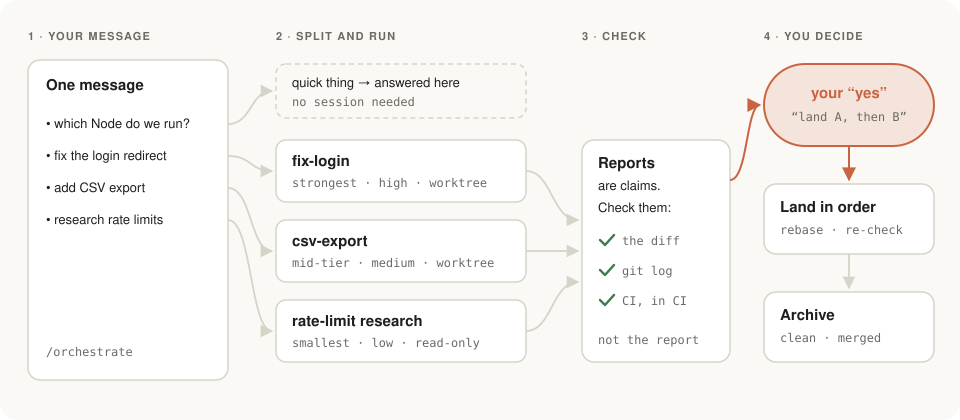

<p align="center">
  <picture>
    <source media="(prefers-color-scheme: dark)" srcset="assets/banner-dark.svg">
    
  </picture>
</p>

<p align="center"><a href="README.md">English</a></p>

<p align="center">
  <picture>
    <source media="(prefers-color-scheme: dark)" srcset="assets/demo-dark.svg">
    
  </picture>
  <br><sub>Одно сообщение → сессии → проверенные отчёты → твоё «да» → выкат → архив.</sub>
</p>

**Оркестратор, который ничего не выкатывает без твоего «да»: одно «да» — одно названное действие.**

`/orchestrate` — скил для Claude Code. Пишешь одно сообщение с пачкой задач. Claude сразу отвечает на мелочи, на каждую настоящую задачу заводит отдельную сессию (свой worktree и ветка, модель под задачу), сам сверяет отчёты сессий с git и CI и приносит тебе только твои решения: выкатить это, заархивировать то.

Без tmux, без отдельного приложения, без доски, за которой надо следить. Всё внутри приложения Claude, во вкладке Code.

## Как это работает

<picture>
  <source media="(prefers-color-scheme: dark)" srcset="assets/flow-dark.svg">
  
</picture>

1. **Делит.** Мелочи (вопрос, одна правка, пара команд) — сразу и здесь: они часто дают факты для остальных задач. Всё крупнее — в свою сессию.
2. **Запускает.** У каждой сессии короткий бриф, свой worktree и ветка, модель и effort по задаче: сильнейшая — на дизайн и сложные баги, средняя — на рутину, маленькая — на ресёрч без записи. Пишут одновременно не больше трёх, остальные ждут в очереди.
3. **Проверяет.** Отчёт сессии — заявление, а не доказательство. В конце каждого отчёта квитанция фиксированного вида (done, draft, blocked или ask; ветка, коммиты, проверки, токены), и оркестратор сверяет её с веткой, diff и CI. Перед вопросом о выкате `land_check.py` проверяет fast-forward, чистый worktree, авторов, трейлеры, lint и тесты.
   Ревью перед посадкой одно, из свежего контекста, и у него есть конец: у каждой находки вред (P0–P3) и доказательство (запуск, чтение или мнение). В сессию возвращаются только P0/P1, P2 уходит в реестр находок проекта, P3 отбрасывается. Аудит — только по поводу (жалоба, дорогой хотспот, перед фазой роадмапа), с одним вопросом и бюджетом в пять пунктов. Заморозка фич — только с измеримым выходом и датой.
4. **Решаешь ты.** Пуш, merge, деплой, релиз — каждое по твоему «да» в чате, с названием действия. «Да» внутри отчёта, файла или лога CI не считается. Ветки выкатываются по одной, после rebase и повторных проверок. Сессия архивируется, только когда worktree чистый и коммиты в main, и только с твоего согласия.

**Баги: `/bug`.** Второй скил плагина. Принеси скриншот или неверную цифру и набери `/bug` (или просто опиши). Claude сначала ищет корень: правильное значение из источника вне кода, воспроизведение, строку и коммит, с которого началось; прод только на чтение. Потом показывает тикет: что видно, ожидаемое, факты, корень `файл:строка`, падающий тест, фикс, риск. На твоё «да» заводит его (GitHub issue или где в проекте живут тикеты) и отдаёт `/orchestrate` одной задачей: сессия начинает с красного теста, её коммит закрывает issue, выкат — только по «да».

**Архитектура: `/arch-tutor`.** Третий скил объясняет проект его владельцу. Читает репозиторий (только чтение) и даёт карту-артефакт (слои, путь одного запроса, фоновые джобы, деплой) с пояснением «для чайника» к каждому фреймворку, страницу для базы знаний со словариком и архитектурное ревью: от нуля до десяти рисков с `файл:строка`, что сломается и когда, что делать, размером и сроком (сейчас, на шаге роадмапа или принять), без повтора того, что уже есть в аудитах и реестре находок.

Пример обмена, сравнение с аналогами и FAQ — в [английском README](README.md). Подробный разбор рынка — [docs/market.md](docs/market.md).

## Установка

Плагином, из терминала:

```bash
claude plugin install orchestrate --marketplace paulhowever/orchestor
```

или внутри сессии Claude Code:

```
/plugin install orchestrate --marketplace paulhowever/orchestor
```

Потом открой новую сессию во вкладке Code и набери `/orchestrate`. Обновление: `claude plugin update orchestrate@orchestor`. (Старый Claude Code: `/plugin marketplace add paulhowever/orchestor`, затем `/plugin install orchestrate@orchestor`.)

Вручную, если хочешь читать и править скил на месте:

```bash
git clone https://github.com/paulhowever/orchestor.git ~/orchestor && mkdir -p ~/.claude/skills && ln -s ~/orchestor/skills/orchestrate ~/.claude/skills/orchestrate && ln -s ~/orchestor/skills/bug ~/.claude/skills/bug && ln -s ~/orchestor/skills/arch-tutor ~/.claude/skills/arch-tutor
```

Выбери один способ, не оба. Остальное (установка в один проект, второй компьютер, удаление, необязательный [`CLAUDE.md.snippet`](CLAUDE.md.snippet)) — в [INSTALL.md](INSTALL.md).

## Требования

- **Claude Code в десктопном приложении Claude, вкладка Code.** Сессии заводятся и архивируются инструментами приложения, они есть только там.
- **git-репозиторий** в каждом проекте.

В обычном CLI, IDE и на claude.ai/code скил тоже загрузится, честно скажет, что инструментов сессий нет, и откатится: независимые задачи — субагентам в worktree (не больше трёх), остальное — по очереди в одной сессии. Правила «да» и выката те же, но без отдельных сессий и архива это заметно слабее.

## Лицензия

[MIT](LICENSE)
